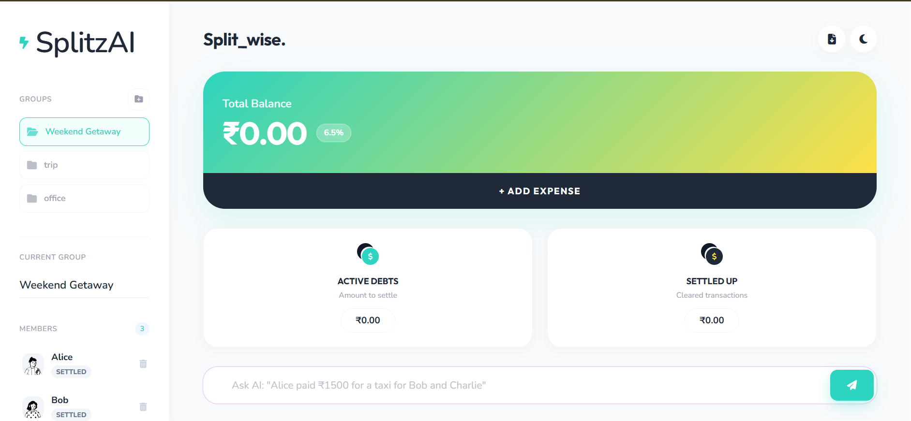

# ⚡ SplitzAI: Smart Expense Splitter



**Pure Vanilla JS. No Frameworks. Pure Power.**

SplitzAI is a premium, AI-powered shared expense tracker and debt simplifier designed for modern groups. Built as a high-performance, framework-less web application, it offers a seamless way to manage group finances with a focus on "Who Owes Whom" simplification.

---

## Key Features

### Multi-Group Ecosystem
- **Workspaces**: Create multiple independent groups (e.g., "Trip to Goa", "Flatmates", "Office Lunch") and switch between them instantly.
- **Persistent Storage**: All groups are locally persisted to `localStorage`, ensuring zero data loss and offline-first capability.

### AI Smart Chat (NLP Parsing)
- **Natural Language Parsing**: Add expenses by simply typing: *"Alice paid ₹1500 for a taxi for Bob and Charlie."*
- **Intelligent Extraction**: The engine automatically identifies the **amount**, the **payer**, the **description**, and the **participants**.

### Advanced Splitting Methods
- **Equally**: The standard way—split the bill across selected members.
- **Exact Amounts**: Specify exactly how much each person owes.
- **Percentages (%)**: Split based on percentages that must sum to 100%.
- **Shares**: Assign different weights (e.g., "Alice: 2 parts, Bob: 1 part").

### Intelligent Debt Simplification
- **Greedy Optimization**: The engine uses a net-balance algorithm to minimize the total number of transactions required to settle up.
- **Settle Up**: One-click settlement that marks debts as paid and updates the shared ledger.

### AI Insights & Categorization
- **Auto-Categorize**: Expenses are automatically tagged (Food, Transport, Accommodation, etc.) using a local keyword-matching NLP engine.
- **Spending Analytics**: Get real-time insights into your group's largest spending categories.

### Premium UI/UX
- **Glassmorphism Design**: A stunning, modern interface with blurred backgrounds, vibrant gradients, and smooth transitions.
- **Native Dark Mode**: Full support for light and dark themes with a persistent preference toggle.
- **Dynamic Avatars**: Unique identifiers for every member using the DiceBear Notionsists API.

---

## Setup Instructions

Since this is built with **zero dependencies**, setting it up is instant:

1. **Clone the Project**:
   ```bash
   git clone https://github.com/username/smart-expense-splitter.git
   ```
2. **Launch**:
   - Simply double-click `index.html` to open it in any modern browser.
   - **No** `npm install`, **No** Node.js, and **No** build steps required.

---

## Architecture Details

### 1. State Management (`app.js`)
The application follows a reactive state-management pattern:
- **`systemState`**: The global object containing all groups and the active group ID.
- **`state`**: A pointer to the currently active group for fast UI updates.
- **LocalStorage Sync**: Every modification triggers a `saveData()` call that serializes the state to the browser's storage.

### 2. UI Layer (`index.html` & `style.css`)
- **Semantic HTML5**: Uses `aside`, `main`, `section`, and `header` for a robust, SEO-friendly structure.
- **CSS Variables**: A centralized color palette and spacing system allow for instant theme switching and maintainability.
- **Flex/Grid Layout**: A responsive main grid that adjusts from desktop sidebars to mobile-optimized stacks.

### 3. Logic Engine
- **Event-Driven Architecture**: DOM listeners handle user interactions and feed data into the logic functions.
- **Validation Layer**: Ensures inputs (amounts, names) are sanitized and logically sound before updating the state.

---

## Feature Implementation (Technical)

### Debt Simplifier Algorithm
The algorithm works in three phases:
1. **Net Balance Calculation**: Iterates through all expenses to find the net "Credit" or "Debit" for each user.
2. **Sorting**: Separates users into two arrays: `creditors` (positive balance) and `debtors` (negative balance), sorted by magnitude.
3. **Greedy Settlement**: Iteratively pairs the largest creditor with the largest debtor to clear balances with the minimum number of edges (transactions).

### NLP Engine
The "AI Chat" uses a combination of:
- **Regex Patterns**: To extract currency patterns (`₹1500`, `500.25`).
- **Keyword Matching**: To identify members and categories from the input string.
- **Fuzzy Mapping**: To match description keywords (e.g., "taxi" -> "Transportation").

### Tech Stack
- **Languages**: HTML5, CSS3, JavaScript (ES6+).
- **Iconography**: [FontAwesome 6.4+](https://fontawesome.com/).
- **Typography**: [Google Fonts (Nunito & Outfit)](https://fonts.google.com/).
- **Avatars**: [DiceBear API](https://api.dicebear.com/).

---

## Deployment

You can host this project for free on any static hosting provider:
- **Vercel / Netlify**: Link your GitHub repo; use the root directory as the build output.
- **GitHub Pages**: Simply enable it in your repository settings under "Pages".

---
*Created as part of the Neev AI Internship Assignment.*
